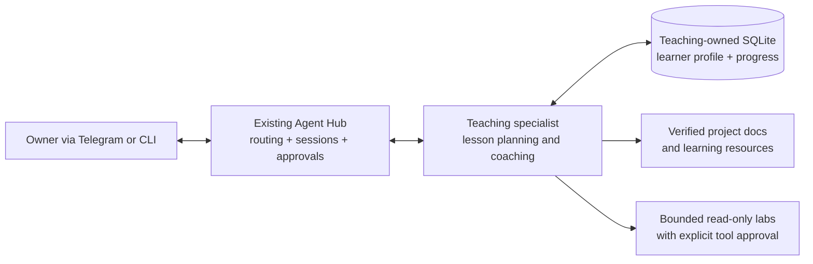

# Adaptive Teaching Agent — proposed specialist design

**Status: PROPOSAL ONLY. No specialist has been built, registered, deployed, or granted access.** Created 28 October 2026 for owner review. Changes to persistent learner profiles, automatic memory updates, course sequencing and specialist integration are product/data/workflow decisions requiring explicit approval after investigation.

## Goal

A reusable personal technical tutor for the Agents platform. Teach AWS Bedrock AgentCore, Harness, Gateway, LangGraph, Deep Agents, Python and enterprise architecture using **the actual current projects as labs**. Adapt teaching to what the owner already knows, what they demonstrably understand, and the teaching style that works best for them. Explain professional and business-analyst implications, not just coding syntax.

This is **not** Hub's existing `/learn` feature. Hub learning stores governed lessons about agent-system operations. A teaching specialist needs a separate, explicitly owned learner profile and lesson/assessment records, not indiscriminate copies of all conversations.

## Proposed architecture

**Ownership:** Agent Factory owns specialist package construction, validation and staging. Agent Hub resolves the specialist and preserves task/session identity, with its existing LangGraph orchestration. The teaching specialist owns pedagogical decisions and its learner records. No duplicate central orchestration framework. Existing project repositories and canonical standards remain authoritative on architecture facts. The tutor does not edit code or perform AWS deployment just because it is teaching.

## Learner model (proposed)

A small, structured, inspectable record rather than unrestricted transcript memory:

| Field | Meaning | Update source |
|---|---|---|
| Topic and skill ID | E.g. `aws.agentcore.harness.invoke` | Curated syllabus |
| Proficiency | Not started / exposed / can explain / can apply / demonstrated | Recorded assessment evidence |
| Evidence | Brief quiz, exercise outcome, reviewed explanation or owner confirmation | Explicit assessment event |
| Last practised | Timestamp of relevant lesson/exercise | Session log |
| Confidence | Learner self-report, separate from demonstrated mastery | Optional learner input |
| Teaching preferences | Pace, examples, level of detail; edit and view on request | Explicit feedback |
| Next suggested activity | One concrete, optional task | Deterministic prerequisites and recent evidence |

No speculative psychological classification, hidden personality inferences, auto-export of private financial data or permanent general ChatGPT Memory changes. Learner can view, correct, export and erase the profile. Retention period and whether lessons are saved automatically require approval.

## Teaching loop

1. **Assess with permission:** Ask what the learner wants to achieve, then do one brief diagnostic; do not assume proficiency from job title or project ownership.
2. **Ground:** Retrieve the relevant authoritative project documentation and, if available, a current read-only implementation snapshot. Mark unavailable verification.
3. **Teach a single concept:** Short explanation, real-project diagram/source excerpt, and the distinction between managed AWS services and custom Python.
4. **Check understanding:** One useful question or hands-on task; wait for the response instead of dumping a lecture.
5. **Evaluate evidence:** Give specific corrective feedback; distinguish self-reported confidence from a successful implementation.
6. **Propose progress update:** Show exactly what skill/level/evidence would be recorded. Never silently change consequential mastery records under the initial proposal.
7. **Choose the next lesson:** Prerequisites, spaced review and user preference guide the recommendation; the user can always redirect.

Boundaries: bounded tool calls and assessment length; no autonomous AWS spending, shell execution, account connections or external posting without the existing explicit approval rules. Stop after one lesson/checkpoint unless the owner requests continuation.

## MVP course — learn from the existing AWS adviser

| Module | Outcome | Practical exercise | Acceptance evidence |
|---|---|---|---|
| 1. System map | Explain Telegram → AWS → Harness → Gateway → calculator | Walk through the verified [platform guide](https://github.com/robvoto/aws-agent-platform/blob/main/docs/AGENTCORE_HARNESS_ARCHITECTURE.md) | Draw/explain ownership of five major components |
| 2. Harness vs LangGraph | Explain managed model/tool loop versus application graph orchestration | Compare Affordability platform source to Hub's LangGraph architecture | Correctly distinguish responsibility boundaries |
| 3. Tools and contracts | Understand tool schema, invocation, read-only evidence and deterministic money | Inspect the two exposed finance tools and their Python result contract | Explain when the model calls each and what it cannot infer |
| 4. Context and state | Understand runtimeSessionId and follow-up dates | Compare a three-month query with a six-month same-chat follow-up | Identify one context failure and how to test it |
| 5. Reliability and trust | Separate unit, Harness and end-to-end evidence | Examine SQS, idempotency, CloudFormation and Telegram receipts | Explain what each test does **not** prove |
| 6. Operational governance | Understand IAM, secrets, budgets and metering | Read-only review of the authorised AWS stack (after identity check) | Describe least privilege and why a budget alert is not a cap |

## Delivery options and recommended staging

**Stage 0 — now:** An interactive lesson can be conducted directly in this ChatGPT conversation. That works immediately but **does not** by itself create an authoritative cross-channel learning profile. Avoid promising durable progress tracking until its storage is implemented and tested.

**Stage 1 — prototype:** Teaching specialist via existing Hub/Factory contracts, using a curated static syllabus and ephemeral session progress. No new AWS resources; test with synthetic project examples and manually confirmed skill evidence.

**Stage 2 — governed persistence:** Teaching-owned SQLite profile, versioned schema/migrations, explicit user review/edit/export/delete, unit tests for progress updates, and bounded retrieval. Decide storage location, retention and approval semantics before implementation.

**Stage 3 — adaptive delivery:** Source-grounded live project exercises, spaced review, individualised lesson sequencing and transparent progress dashboard/status via existing interfaces. Read-only by default, tool-use limits and clear cost warnings.

## Decisions required before implementation

- Where should the learner profile live (local WSL SQLite, an already authorised service, or another explicit location)?
- May a lesson update proficiency automatically from an exercise result, or must the user approve every persisted assessment?
- Should the first access channel be existing Agent Hub Telegram/CLI, ChatGPT, or both (bearing in mind they do not share arbitrary memory by default)?
- What data retention/export/delete policy is appropriate?

Do not fabricate compatibility between ChatGPT Memory and the Hub SQLite state. Sharing learning progress across products requires an explicit supported integration, authentication and consent.

## Bounded engineering acceptance checklist

- Architecture and data ownership reviewed against canonical standards and current Factory/Hub code.
- New specialist is staged through Factory's approved lifecycle, not copied into Hub manually.
- Tests show correct use of current project documentation and no hallucinated live code facts.
- Profile records only explicit assessment evidence, with learner review/correction; deny tests for another user/session.
- Consent, export, deletion and backup/restore tested for any durable learner data.
- Demonstrate an end-to-end lesson, follow-up, and knowledge check without uncontrolled tool calls or redundant approval prompts.
- Record validation results and integrate with `main` using the relevant repo Git lifecycle. Do not call a design proposal a released agent.
